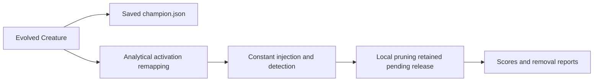

## Summary

Audited existing structural rewrites and froze deterministic neuron-pruning behaviour before the
shared Rust cutover. Corrected the documentation to distinguish the saved evolved champion from its
pruned analytical copy. Runtime migration remains release-gated. Part of #899.

## Spec

### Intent and Rationale

- Replace the duplicated constant-fold implementation once the supported released adapter is
  available; preserve the current behaviour first.
- The audit found one local compaction rewrite. Synthetic-edge pruning and demonstration setup have
  separate purposes and retain their current paths.

### Essential Design Decisions

- The parent release contract takes precedence over an immediate cutover: the core API and
  TypeScript adapter must be merged, green and released, with verified native/WASM artefacts, before
  production changes.
- Keep constant injection, sampled variance detection, analytical activation remapping, held-out
  scoring, original-index reports and milestone telemetry.
- Pruning acts on an analytical copy; the saved champion is the original evolved Creature. A future
  rejected or unsupported candidate must preserve its original snapshot. No rejection adapter is
  implemented in this change.
- The fresh evolution seed remains uniform-random `new Creature(4, 2)`; the hand-crafted test
  fixture and post-evolution injection do not seed evolution.

### Undiscoverable Facts

- On 26 November 2026, `gh issue view` reported both required upstream issues open. The recorded
  same-repository dependency #776 is a closed, unrelated chart issue; it does not satisfy this
  migration's release gate.
- Targeted evolution tests returned success while logging missing native backpropagation errors.
  Their result does not establish native training parity.

## Evidence

- Base audited: `b8b2d87a43e54a7837baace267c10d8fde81f9a5`. `deno.json`, `deno.lock` and Deno
  resolution agree on NEAT-AI 7.0.62.
- [NEAT-AI-core#779](https://github.com/stSoftwareAU/NEAT-AI-core/issues/779): “Compaction migration
  3: publish one native/WASM compaction API with parity gates” — open.
- [NEAT-AI#4196](https://github.com/stSoftwareAU/NEAT-AI/issues/4196): “Compaction migration 4A:
  switch TypeScript compact callers to shared Rust engine” — open.
- [NEAT-AI-core#775](https://github.com/stSoftwareAU/NEAT-AI-core/issues/775): “Family-wide DRY:
  unified Rust creature compaction — staged migration tracker” — requires released compatible pins
  and verified artefacts before consumer cutover.
- #776: “🟡 Chart scale and tick maths duplicated across three SVG chart renderers” — closed.
- #899: “Compaction migration 4: audit and converge on shared Rust compaction”.
- Release discovery found NEAT-AI v7.1.41 and core v0.23.11, plus the core WASM bundle for
  `9ef3668def917ffa3266c212d2990f1c77cab27d`. Release existence alone does not satisfy the open
  issues' acceptance gates; no compaction cutover artefact or family CI parity has been verified.
- Backend test/documentation change; no rendered visual surface changed.
  `neuron_pruning/neuron_pruning_test.ts` exercises real Creature exports and production detection,
  pruning, forward evaluation and scoring.

## Audit record

- [x] Check the release gate: on 26 November 2026, NEAT-AI-core#779 and NEAT-AI#4196 are open. The
      checkout resolves NEAT-AI 7.0.62.
- [x] Inspect `neuron_pruning/neuron_pruning.ts`: `pruneConstantNeurons` folds constant
      contributions, removes neurons and reindexes synapses. It acts on an analytical copy, while
      `champion.json` saves the evolved Creature.
- [x] Inspect `synthetic_synapse/synthetic_synapse_example.ts`: `pruneCreature` removes only
      recorded synthetic edges below its threshold; retain it.
- [x] Finish the production source audit: no explicit shared compaction calls found; the local
      bias-fold rewrite is the migration target.
- [x] Freeze chained folding, removal reports, topology reduction, no-op behaviour, genuine Creature
      serialisation and held-out score parity.
- [ ] Migrate to the released adapter after the upstream release gate passes.

| Source area                                                     | Finding                                                                                                                                                                           |
| --------------------------------------------------------------- | --------------------------------------------------------------------------------------------------------------------------------------------------------------------------------- |
| `neuron_pruning/neuron_pruning.ts`                              | `pruneConstantNeurons` is the duplicated structural rewrite; `runNeuronPruningDemo` calls it after analytical remapping and constant injection.                                   |
| `synthetic_synapse/synthetic_synapse_example.ts`                | `pruneCreature` removes recorded synthetic edges below the configured threshold; preserve this strategy.                                                                          |
| `discovery/discover_missing_neuron.ts`                          | `createCrippledCreature` removes a named neuron for the legacy discovery setup; it is not a constant-fold or whole-creature compaction pass. The current runner does not call it. |
| `crispr_injection/crispr_injection.ts`, `tsp_two_opt/hybrid.ts` | `injectGene` adds a gene and remaps indices; it does not compact a creature.                                                                                                      |
| `intelligent_design/improve_squash_example.ts`                  | Squash scan and application, without a local structural compaction pass.                                                                                                          |
| Factory seed paths, including MNIST and stock market            | Delegate to `Creature.forDataset`; constant-input pruning is owned upstream.                                                                                                      |
| Other examples, shared helpers and scripts                      | No explicit compaction API call or additional equivalent local rewrite found by the source scan. Evolution and factory internals remain owned by NEAT-AI.                         |

The scan covered tracked TypeScript sources, then shell/JS/Rust sources, for `compact`, `simplif`,
`prun`, `removeNeuron`, `disconnect`, `splice` and bias addition. A second scan inspected
neuron/synapse replacement and filtering; the candidate functions and their callers were read to
distinguish setup, strategy and compaction. Graft was attempted but returned "no graph".

## Acceptance Criteria

- **missing** — Replace existing compaction with shared Rust core API (or released NEAT-AI adapter),
  keeping only strategy-specific logic. — reason: the required core and adapter issues are open; the
  local rewrite is retained until their merged, green, released APIs are verified.
- **missing** — Use latest compatible merged/released pins and normal dependency sync; verify all
  existing tests, compatibility of serialized creatures and relevant performance/score semantics. —
  reason: current-version deterministic parity is covered, but shared-engine pins, full
  compatibility, native/WASM parity and performance cannot be accepted before the upstream releases.

## Test Plan

- Added
  `neuron_pruning/neuron_pruning_test.ts::pruneConstantNeurons - freezes chained folds,
  removal reports and held-out scores`:
  known outputs, two constant neurons (including a chain), 7 → 5 neurons, 11 → 4 synapses, exact
  original-index reports and held-out score `-0.078125`. A second detection/prune is a no-op; the
  champion export stays unchanged.
- Added
  `neuron_pruning/neuron_pruning_test.ts::pruneConstantNeurons - preserves genuine Creature
  serialisation without pruning the champion`:
  validates an exported/imported Creature, checks its known outputs, and checks analytical pruning
  parity and unchanged exported state.
- Strengthened
  `neuron_pruning/neuron_pruning_test.ts::pruneConstantNeurons - returns empty when no
  constants are supplied`:
  checks the complete network value. The earlier empty-report and unchanged-neuron-count assertions
  remain covered; no supported behaviour assertion was removed.
- These are legacy parity fixtures, expected green against the unchanged implementation, rather than
  a bug reproduction. No runtime compaction algorithm was changed and no red regression is claimed.
- Targeted `deno fmt`, `deno lint` and `deno check --frozen` passed.
- `deno test --frozen --allow-read --allow-write --allow-env --allow-net --allow-ffi
  neuron_pruning/neuron_pruning_test.ts common/feed_forward_network_test.ts`
  passed: 35 tests. The existing evaluator tests cover unsupported activation rejection and opt-in
  TANH remapping. Evolution tests logged `neat_ai_backpropagation library/binary was not found`
  despite passing.
- `deno test --frozen --allow-read --allow-write --allow-env --allow-net --allow-ffi
  synthetic_synapse/synthetic_synapse_example_test.ts --filter pruneCreature`
  passed: 2 tests, covering synthetic-edge membership/threshold pruning and negative-threshold
  refusal.
- `timeout 900 ./quality.sh < /dev/null` timed out with exit `124` during parallel unit tests.
  Repository formatting, Bash syntax, lint and type checking passed; the native scorer built. The
  full unit suite produced no final verdict, and the isolated integration suites and example runs
  were not reached. Watchdog worker imports also logged `runtime dropped the dispatch task`; the dot
  reporter does not identify which remaining test consumed the timeout. No retry was run.

## Deno regression avoided

Used the existing Deno fixture, test runner, formatter, linter and type checker.

## Remaining limitations

Shared-engine migration, candidate rejection/rollback, native/WASM compaction parity, released-pin
compatibility and performance remain unverified. Sampled low variance can identify approximately
constant neurons; the current demo reports scores without a candidate acceptance veto. No benchmark
or private deployment check was run. The complete quality gate remains unverified after its timeout;
resume it with `timeout 900 ./quality.sh < /dev/null` once the release gates are satisfied.
